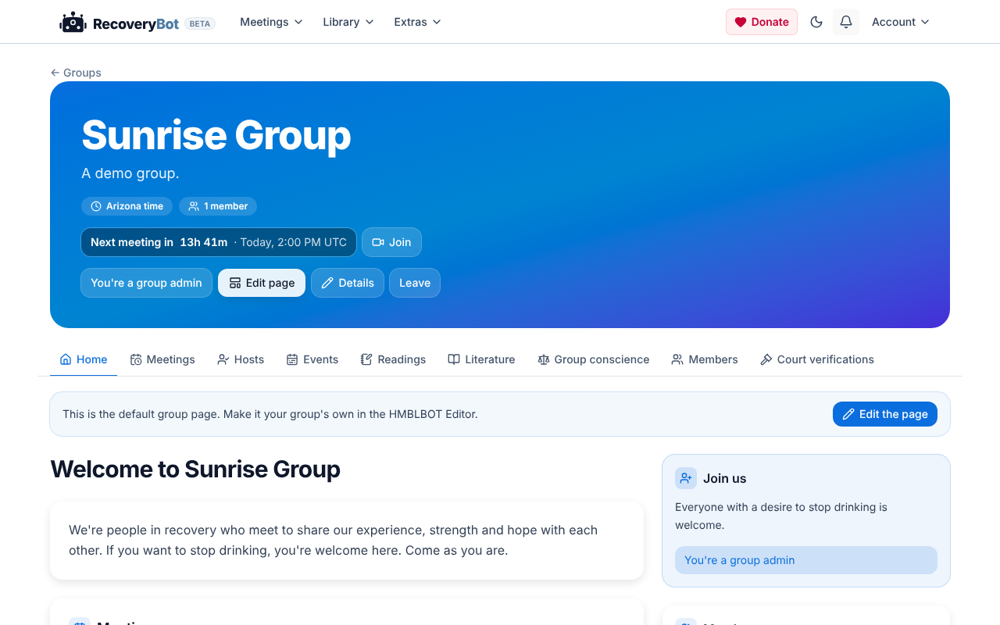
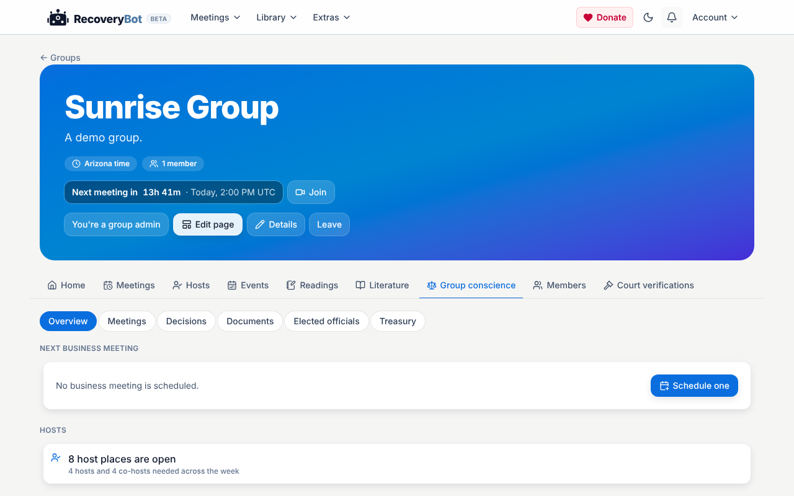
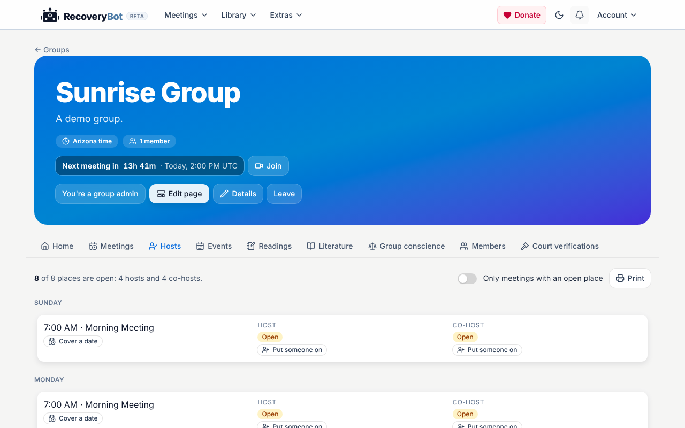
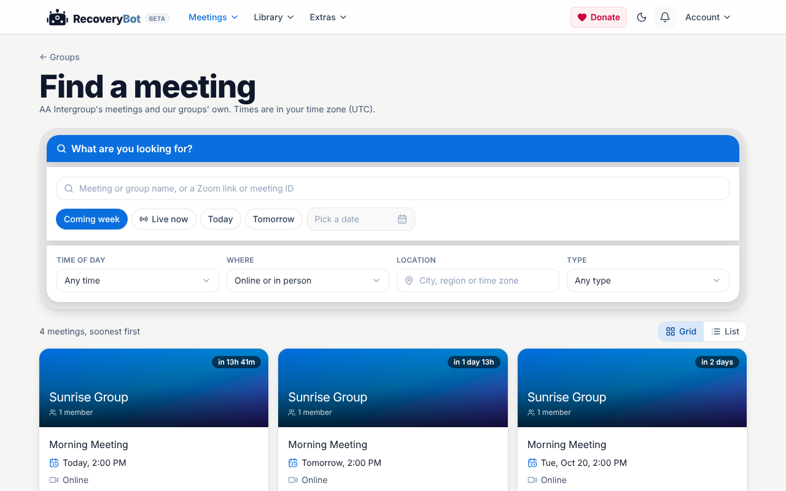

# RecoveryBot

A platform for running 12-step recovery groups: a literature library, group pages and meetings, and the record-keeping a group's business meeting needs.

**Live:** https://recoverybot.hmblbot.com

## Screenshots

| Group home page | Group conscience |
| --- | --- |
|  |  |
| **Host scheduling** | **Public meeting finder** |
|  |  |

The screenshots show the app running locally with made-up demo data.

## Features

### Library
- Recovery books with search across all of them, and a chapter reader
- Shareable highlights with Markdown notes
- Problem reports on text
- Admin book and chapter editor

### Groups
- Memberships, with admin and member roles
- Meetings linked to the AA Intergroup directory
- Group home pages and events built in a Tiptap-based page editor
- Approved literature per group
- Court-verification forms and emails

### Group conscience
- Bylaws and policies as live documents, with PDF export and Word/RTF import
- A decision log
- Business meetings with agendas, minutes, quorum and unfinished business
- Robert's Rules checks on records (the app records what the room decided; it never blocks)

### Service
- Treasurer's reports with the prudent reserve and the split
- Officer terms and rotation reminders
- Host scheduling for 28 weekly meetings, with open-spot flags and one-day covers

### Community
- Profiles, follows and timeline posts
- A public meeting finder
- Schedule polls with a vote heat map

### Admin
- Overview, analytics, users, readings, tags and court verifications

## Tech stack

- **Backend:** Ruby 3.2.3, Ruby on Rails 8, PostgreSQL, Devise for accounts, Active Storage, Ahoy for analytics, Sentry for error reporting
- **Frontend:** React 19 with Stimulus and Turbo, bundled by Vite (`vite_rails`), styled with Tailwind CSS 4 and Bootstrap
- **Editors:** Tiptap and Lexical
- **Documents:** pdf.js and mammoth (browser-side PDF reading and Word import)
- **Tests:** Rails' built-in Minitest, with Capybara system tests
- **Deployment:** Docker on CapRover

## Local setup

You need Ruby 3.2.3, Node.js (the Dockerfile uses 20.x) and PostgreSQL.

```sh
bundle install
npm ci
bin/rails db:create db:schema:load
```

Then run the Rails server and the Vite dev server (two terminals):

```sh
bin/rails s
bin/vite dev
```

The app is at http://localhost:3000. `bin/rails db:seed` does not work on an empty database (it expects an existing topic set), so create content through the app or the importers in `lib/tasks/`.

A few features are behind environment variables:

| Variable | Effect |
| --- | --- |
| `ADMIN_EMAILS` | Comma-separated emails of site admins who can use the admin suite and Groups |
| `GROUPS_FOR_EVERYONE=1` | Opens Groups to every account |
| `AA_INTERGROUP_FEED_URL` | Overrides the AA Intergroup meeting feed |

## Tests

```sh
bin/rails test           # unit, controller and integration tests
bin/rails test:system    # browser tests (needs Chrome)
```

The front end must be built once (`npx vite build`) before controller tests that render pages can pass.

## Deployment

The app deploys to CapRover from the `Dockerfile` and `captain-definition`. The image builds the Vite assets, and the container runs `rails db:migrate` and then Puma on start.

See `AGENTS.md` for an architecture guide to the codebase.
